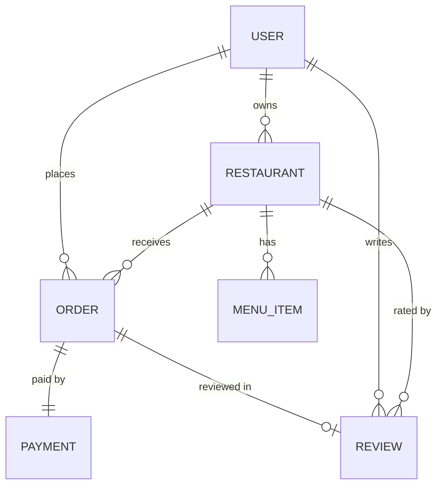

# Spicebox: Food Ordering Platform

Full-stack **TypeScript** food ordering app: React frontend, Express + MongoDB backend, role-based auth
(customer / owner / admin), restaurants, menus, orders and multiple payment methods. Neo-brutalist x neumorphic UI in
orange / red, white and charcoal.

> **Status: Stage 1 of 26 complete** (foundation + design system). See [`docs/ANTIGRAVITY_STAGES.md`](docs/ANTIGRAVITY_STAGES.md)
> for the build plan. Live URL: _added in stage 25_.

## Quick start

```bash
# Backend (http://localhost:5000)
cd backend
npm install
cp .env.example .env      # set MONGO_URI and a JWT_SECRET (16+ chars)
npm run dev

# Frontend (http://localhost:3000)
cd frontend
npm install
cp .env.example .env
npm start
```

Open `http://localhost:3000/styleguide` to see the whole design system. Health check: `GET /api/health`.

## Tech

| Layer | Choice |
|---|---|
| Frontend | React (Create React App), TypeScript strict, React Router, hand-written CSS (no UI library) |
| Backend | Express, Mongoose, zod, helmet, JWT |
| Language rules | `strict` + `noImplicitAny`, no `any`, generics for shared helpers |

## Pages (11 routes, 3 built so far)

Home, Restaurants, Restaurant menu, Cart, Checkout, My orders, Order details, Login, Register, Profile, Owner dashboard,
Admin dashboard, About, Style guide, 404. Placeholders are labelled with the stage that builds them.

## Planned data model (6 collections)



## Roles

| Capability | Customer | Owner | Admin |
|---|---|---|---|
| Browse restaurants and menus | yes | yes | yes |
| Place and track own orders | yes | - | - |
| Manage own restaurant and menu | - | yes | yes |
| Move orders through statuses | cancel while pending | own restaurants | all |
| Approve restaurants, manage users | - | - | yes |

Admins are created by the seed script only; registration never grants `admin`.

## Payment methods

| Method | Status |
|---|---|
| Cash on delivery | Real flow |
| Card | Stripe **test mode** (needs your own test keys) |
| JazzCash / Easypaisa | **Simulated demo** (no merchant credentials) |

## What was verified in Stage 1

- Backend: strict typecheck + build pass; env validation fails fast; `/api/health`, 404, malformed JSON (400) and oversized
  body (413) all return the contract-shaped error; CORS preflight allows the client origin.
- Frontend: strict build passes with warnings treated as errors; 4 render tests pass (Home, About, Style guide, 404).
- **Not verified:** visual appearance in a real browser, and anything involving MongoDB (none available when this was
  built). Check the pages in a browser before relying on the look.
